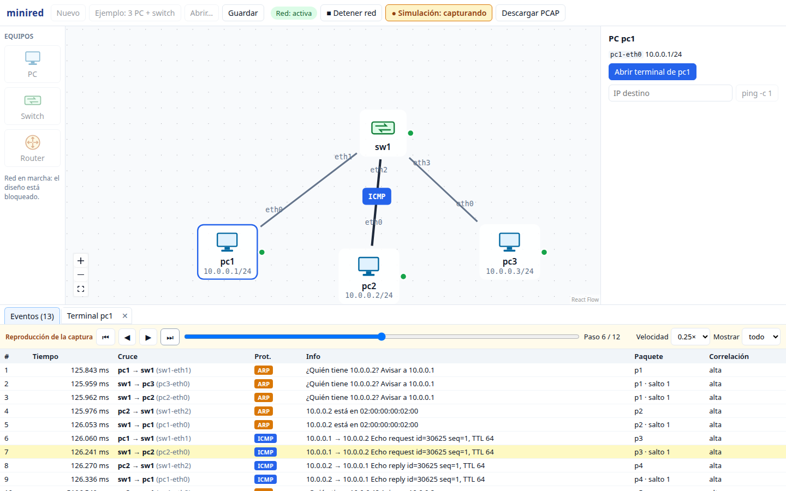

# minired

Laboratorio de redes sobre [Mininet](https://github.com/mininet/mininet) con interfaz web y
**modo simulación de tráfico real**. Se arma la topología en el navegador (PC, switch, router),
se inicia una red Mininet de verdad y, con la simulación activa, cada paquete que cruza un enlace
se captura en los dos extremos, se correlaciona y se reproduce paso a paso: se ve cómo un switch
inunda un ARP por todos sus puertos y cómo el eco ICMP va solo hacia su destino.



Minired usa como motor el fork educativo
[mendezgarabetti/mininet](https://github.com/mendezgarabetti/mininet) (2.3.1b4+edu.1).
Los laboratorios del curso REDES101 están en
[fosshlab/redes101](https://github.com/fosshlab/redes101).

## Estado: MVP

Funciona y está probado con root en una VM de laboratorio:

- Editor de topología (PC, switch OVS sin controlador, router Linux) con validación de
  direcciones, puertos y bucles.
- Iniciar y detener la red; terminal web (bash) dentro del namespace de cada nodo.
- Simulación: `tcpdump -Q in` en cada extremo de cada enlace, correlación con ramas cuando un
  switch inunda, reproducción paso a paso, capas decodificadas por tshark y descarga de un PCAPng
  (una interfaz por extremo). Lo que no se puede correlacionar se muestra como observación suelta:
  no se inventan paquetes.

Prácticas tipo CCNA (etapa 3), cada una con un ejemplo listo en el menú **Ejemplos** y una prueba
con root que también verifica que no quedan restos:

- VLAN de acceso y troncales 802.1Q en OVS, e inter-VLAN con router-on-a-stick (subinterfaces).
- Router con FRRouting aislado por namespace: `vtysh`, rutas estáticas y OSPF.
- Servidor con DHCP y DNS (dnsmasq) y HTTP; PC que piden IP por DHCP.
- NAT (PAT) y ACL de entrada con nftables, con contadores visibles.

La simulación muestra la etiqueta VLAN de cada trama, decodifica DHCP, DNS, HTTP y OSPF y sigue un
paquete a través de un NAT (con confianza "baja"). Todavía no: STP, LACP, IPv6 ni edición con la red
en marcha.

## Requisitos

Una VM o máquina Linux dedicada (probado en Ubuntu 24.04) con:

- el fork de Mininet instalado, Open vSwitch, tcpdump, tshark y ethtool;
- para la etapa 3: FRRouting (`frr`), dnsmasq, nftables, busybox y curl;
- Python 3.10 o posterior y, para compilar la interfaz, Node.js 18 o posterior.

Minired necesita root (crea namespaces, veth y bridges): usalo en una VM de laboratorio,
no en tu equipo de trabajo.

## Instalar y correr

```bash
git clone https://github.com/fosshlab/minired && cd minired
python3 -m venv --system-site-packages ~/.venvs/minired   # para ver el paquete mininet del sistema
~/.venvs/minired/bin/pip install -e '.[pruebas]'
(cd gui && npm ci && npm run build)
sudo ~/.venvs/minired/bin/python -m minired gui
```

El comando muestra `http://127.0.0.1:8787/#token=…`: abrí esa dirección completa en el navegador
de la misma máquina, o desde tu equipo con un túnel `ssh -L 8787:127.0.0.1:8787 usuario@vm`.

Uso detallado, pruebas y funcionamiento de la simulación: [docs/gui.md](docs/gui.md).

## Seguridad

- El servidor escucha **solo en 127.0.0.1**; no hay opción para exponerlo en la red.
- Cada arranque genera un **token** aleatorio: se exige en REST (`Authorization: Bearer`) y en
  WebSocket (subprotocolo), junto con el Origin. Se valida el Host (DNS rebinding), no hay CORS y
  la página usa una CSP estricta.
- La terminal es una shell root dentro del namespace del nodo: pensado para una VM por estudiante.

## Licencia

Código propio bajo [BSD-3-Clause](LICENSE). Créditos a Mininet y demás terceros en
[NOTICE](NOTICE) y [AGRADECIMIENTOS.md](AGRADECIMIENTOS.md).
